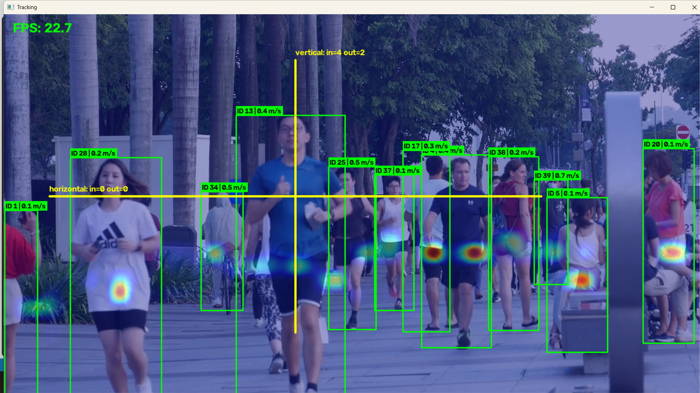
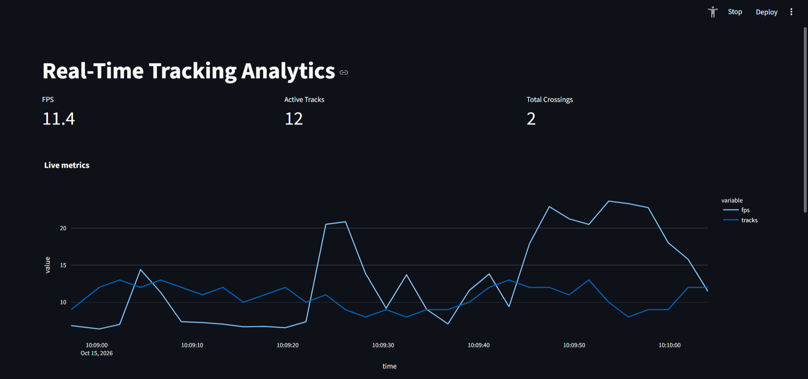

End-to-end система компьютерного зрения для трекинга объектов в реальном времени
с аналитикой: подсчёт пересечений линий, оценка скорости через гомографию,
тепловые карты посещаемости.


<video src="docs/demo.mp4" controls width="700"></video>

### Запуск пайплайна

```bash
python -m src.run --source data/sample.mp4 --output out.mp4 --show --heatmap
```

### Запуск API + дашборда

В первом терминале:
```bash
uvicorn src.api.main:app --reload --port 8000
```

Во втором:
```bash
streamlit run src/ui/dashboard.py
```

Открой [http://localhost:8501](http://localhost:8501) — увидишь live-метрики.

## Docker

```bash
docker compose -f docker/docker-compose.yml up --build
```

Поднимает: API (`:8000`), PostgreSQL (`:5432`), Redis (`:6379`), Dashboard (`:8501`).

---




